<div align="center">


# AniVault

**An offline-first anime tracker for Android, with a locked private vault and two-way sync to AniList, MyAnimeList and Kitsu.**

Kotlin · Jetpack Compose · Material 3 · Room + SQLCipher · No ads, no analytics

</div>

---

## Screenshots

<table>
  <tr>
    <td>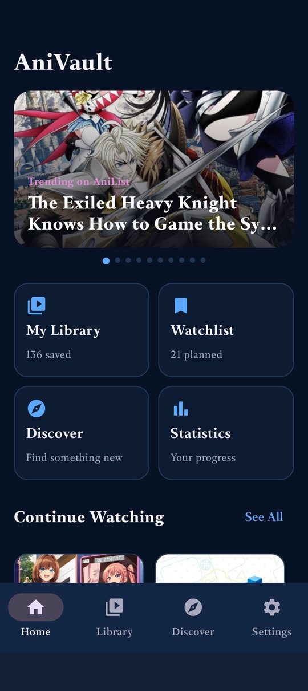<br/><sub>Home: trending carousel, quick links, continue watching</sub></td>
    <td>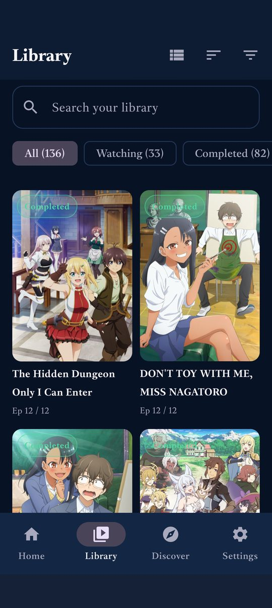<br/><sub>Library, grid view with status filters</sub></td>
    <td>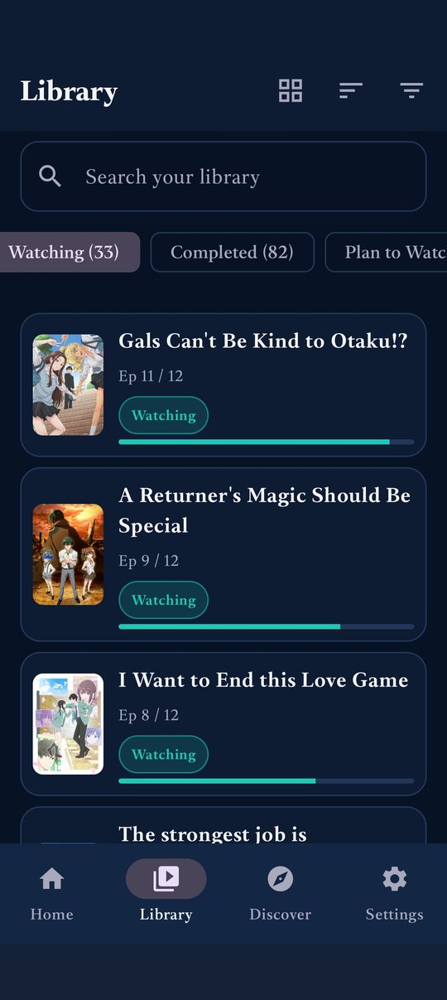<br/><sub>Library, list view with progress bars</sub></td>
  </tr>
  <tr>
    <td>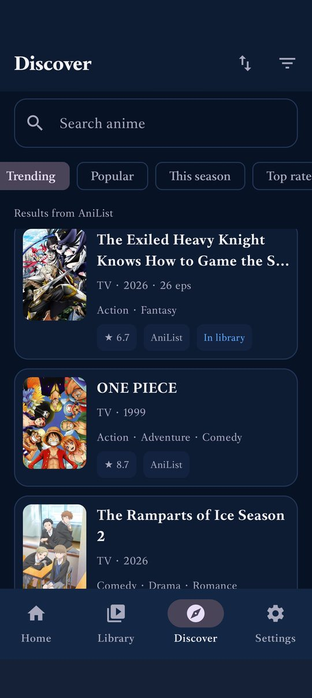<br/><sub>Discover: trending, popular, this season, top rated</sub></td>
    <td><br/><sub>Title sheet with synopsis and one-tap add</sub></td>
    <td><br/><sub>Edit status, progress, rating and notes</sub></td>
  </tr>
  <tr>
    <td>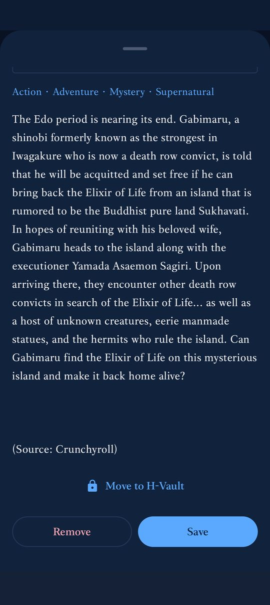<br/><sub>Move a title to H-Vault from its sheet</sub></td>
    <td>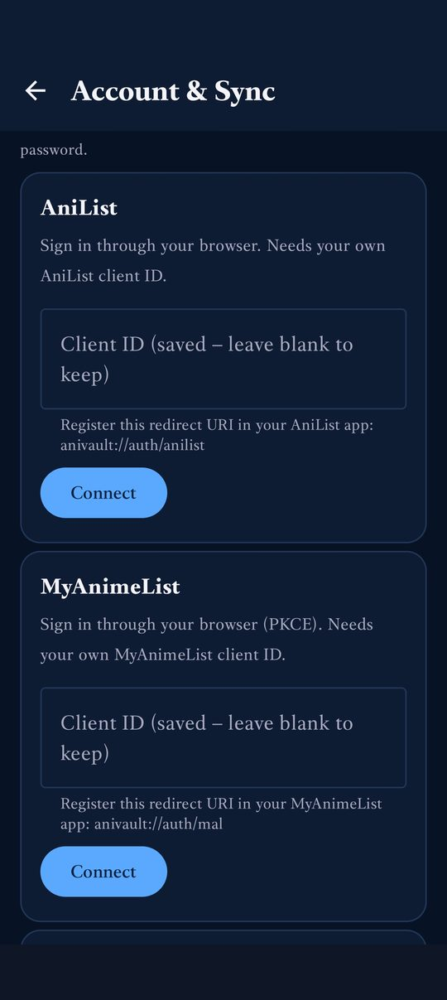<br/><sub>Account &amp; Sync</sub></td>
    <td>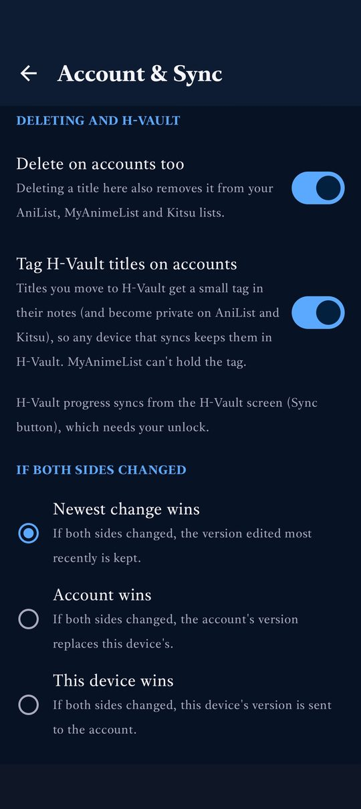<br/><sub>Delete-on-account and H-Vault tag options</sub></td>
  </tr>
  <tr>
    <td>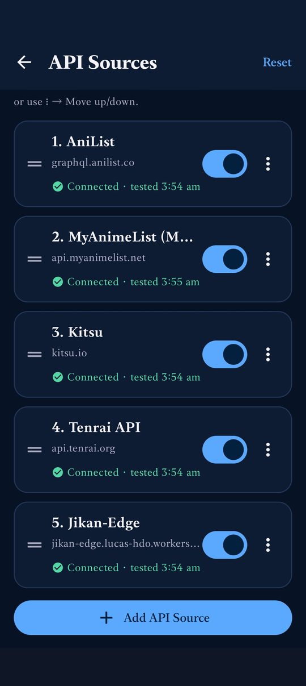<br/><sub>API Sources with fallback order</sub></td>
    <td>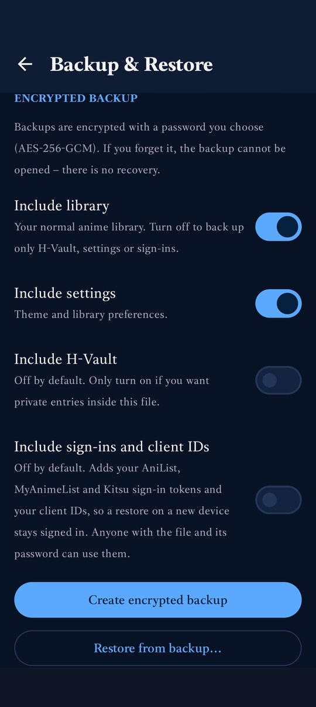<br/><sub>Encrypted backup with per-part toggles</sub></td>
    <td>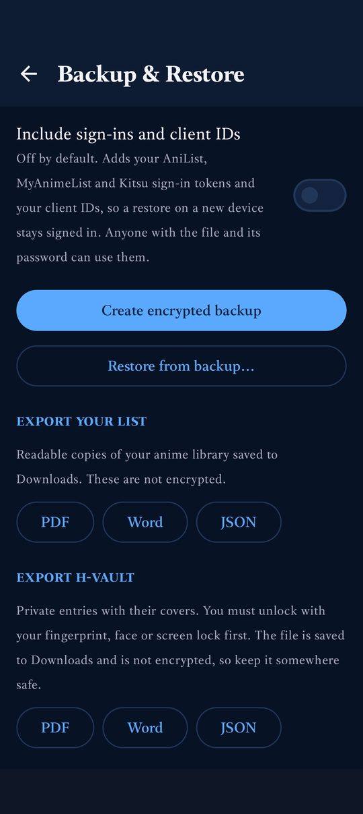<br/><sub>PDF / Word / JSON export, library and H-Vault</sub></td>
  </tr>
  <tr>
    <td>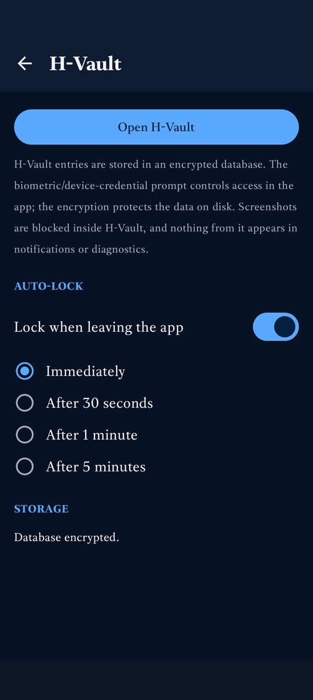<br/><sub>H-Vault lock and auto-lock settings</sub></td>
    <td>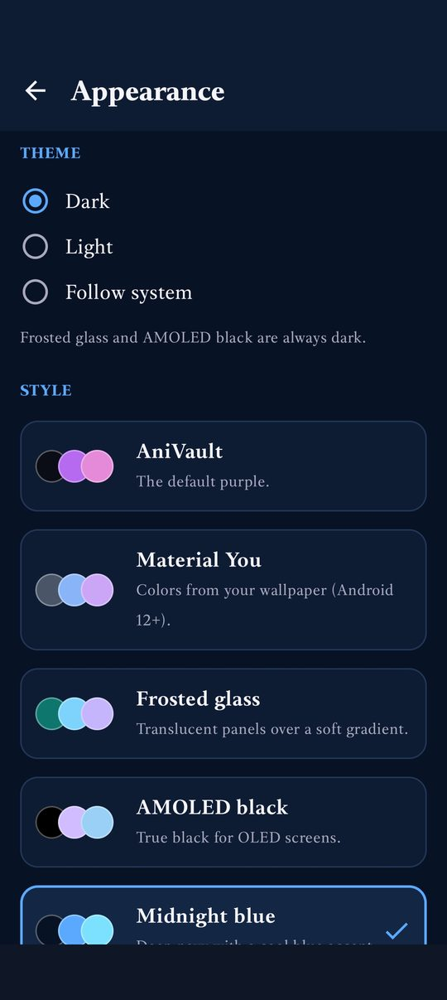<br/><sub>Appearance: theme mode</sub></td>
    <td>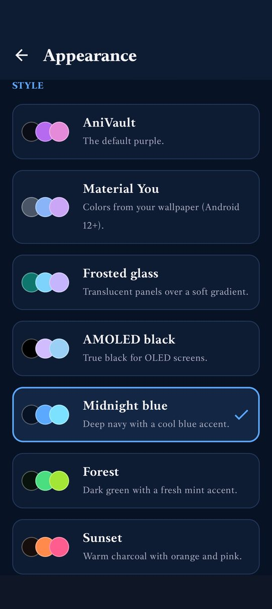<br/><sub>Style picker (Midnight blue selected)</sub></td>
  </tr>
</table>

## Features

**Library**
- Track status, episode progress, rating, dates and notes; grid or list view, search, status filters and sort.
- Multi-select to change status, delete or move titles in bulk, with undo.
- Marking a title *Completed* fills its progress; reaching the last episode completes it automatically (configurable).
- Watch-time statistics and per-title remaining-time estimates.

**Discover**
- Trending, popular, this season, top rated and recently updated, from the sources you enable.
- Filters: genre, status, country, format, minimum score, year and episode count. Narrow filters keep loading pages until the list fills.
- Sort results by score, date, title or episode count. Tap any result to read the synopsis and add it.

**Sources with fallback**
- AniList (GraphQL), MyAnimeList v2, Jikan-compatible REST, Jikan-Edge, Kitsu and Tenrai are supported.
- Sources are tried in your order; a failure or empty result falls through to the next. See [API_SOURCES.md](API_SOURCES.md).

**Account sync (AniList, MyAnimeList, Kitsu)**
- Two-way sync of status, progress, score and dates, with a conflict policy you choose.
- Changes made offline queue and go out later. AniList requests are spaced out and batched to respect its rate limit.
- Optionally delete a title on your accounts when you delete it in the app.
- Adult-rated titles from your accounts are kept out of the normal library.

**H-Vault**
- A separate library for adult titles, behind biometric or device-credential unlock with auto-lock.
- Same layout and behaviour as the main library, with its own search and its own source list.
- Move any title between the library and H-Vault by hand, for series that are not tagged as adult. Moved titles stay in H-Vault across syncs; on AniList and Kitsu they get a small tag in their notes (and become private) so another device restores them in the right place.
- H-Vault progress syncs from inside the unlocked vault.

**Backup and export**
- Encrypted backup (AES-256-GCM, password-based) with toggles for library, H-Vault, settings, and sign-ins/client IDs.
- Export your list as PDF, Word or JSON with covers, synopsis and watch time. Exporting H-Vault needs authentication.

**Look and feel**
- Dark, light or follow-system, plus styles: AniVault, Material You, Frosted glass, AMOLED black, Midnight blue, Forest, Sunset and Sakura.

## Install

Download an APK from the [Releases](../../releases) page.

| File | Use it on |
| --- | --- |
| `AniVault-foss-release-arm64-v8a.apk` | Almost all phones made in the last several years |
| `AniVault-foss-release-armeabi-v7a.apk` | Older 32-bit ARM phones |
| `AniVault-foss-release-x86_64.apk` / `x86.apk` | Emulators and some Chromebooks |
| `AniVault-foss-release-universal.apk` | Not sure? Works everywhere, but is larger |
| `AniVault-debug-universal.apk` | Debug build with an in-app log screen, for bug reports |

Requires Android 8.0 (API 26) or newer. You may need to allow installs from your browser or file manager.

**Updating:** builds are signed with one fixed key, so a new APK installs over the old one. If an update is refused with a signature error, the installed copy was signed with a different key: make an encrypted backup (turn on *Include sign-ins and client IDs* if you want them), uninstall once, install, then restore.

## Connecting accounts

- **Kitsu:** sign in with your email and password. They go only to Kitsu and are not stored.
- **AniList and MyAnimeList:** create your own API client in each service's developer settings, register the redirect URI shown in the app (`anivault://auth/anilist` or `anivault://auth/mal`), enter the client ID in *Settings → Account & Sync*, then sign in through your browser. AniVault never sees your password.
- MyAnimeList cannot hold the H-Vault tag or a private flag, so on MAL a title stays in H-Vault through the record kept on your device.

## Privacy

- No ads, no analytics, no tracking. The app talks only to the sources and accounts you enable.
- The library and H-Vault live in an encrypted on-device database (SQLCipher).
- Sign-in tokens are stored in encrypted storage, and are included in a backup only if you turn that on.
- H-Vault is hidden from screenshots and from notifications.

## Build from source

Requirements: JDK 17 and the Android SDK (compileSdk 34).

```bash
./gradlew assembleDebug          # debug APKs in app/build/outputs/apk/debug
./gradlew assembleRelease        # R8-shrunk release APKs, one per ABI plus a universal build
./gradlew testDebugUnitTest lintDebug
```

Release builds are signed with the debug keystore found in `ANDROID_USER_HOME/.android/debug.keystore`. CI supplies a fixed key from the repository secret `ANIVAULT_KEYSTORE_B64` (base64 of the keystore, alias `androiddebugkey`, password `android`); without it a throw-away key is generated and the build says so. Never commit a keystore to a public repository.

## Continuous integration

`.github/workflows/android-build-smoke-test.yml` runs six stages: **Plan**, **Gate 1** (build, unit tests, lint), **Release APK** (R8), **Stage 2** (emulator install, launch and smoke test on API 34), **QA report**, and **Publish Release** (on `v*` tags or a manual run with *publish* ticked). Details are in [docs/ANDROID_CI.md](docs/ANDROID_CI.md).

## Project layout

```
app/src/main/java/com/anivault
├── data/provider   # source adapters, fallback engine, filters
├── data/sync       # AniList / MAL / Kitsu clients, planner, queued operations
├── data/library    # repositories, progress rules, library ⇄ H-Vault moves
├── data/backup     # encrypted backup and restore
├── ui              # Compose screens: home, library, discover, vault, settings, export
└── core, di, notify
```

## Notes

- Anime data and artwork belong to their respective sources (AniList, MyAnimeList, Kitsu and others) and are fetched at runtime.
- AniVault is an independent project and is not affiliated with any of these services.
